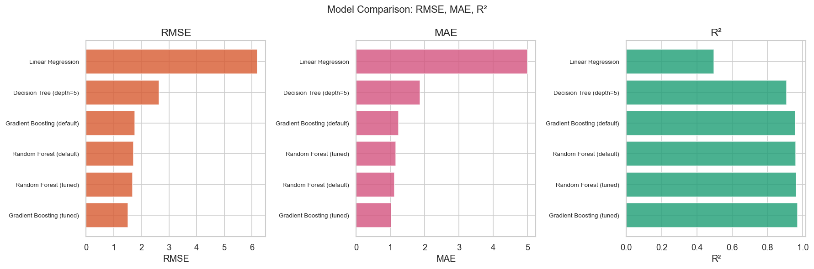
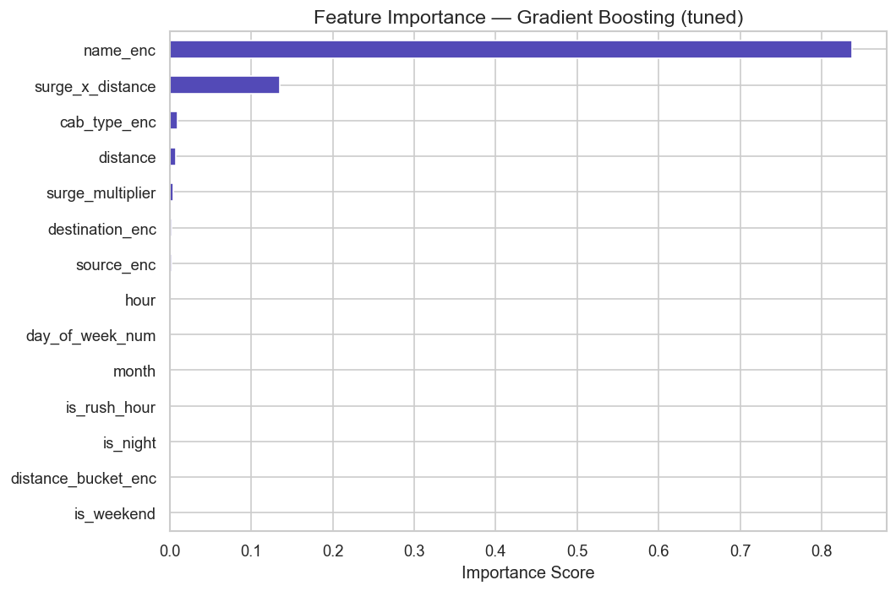
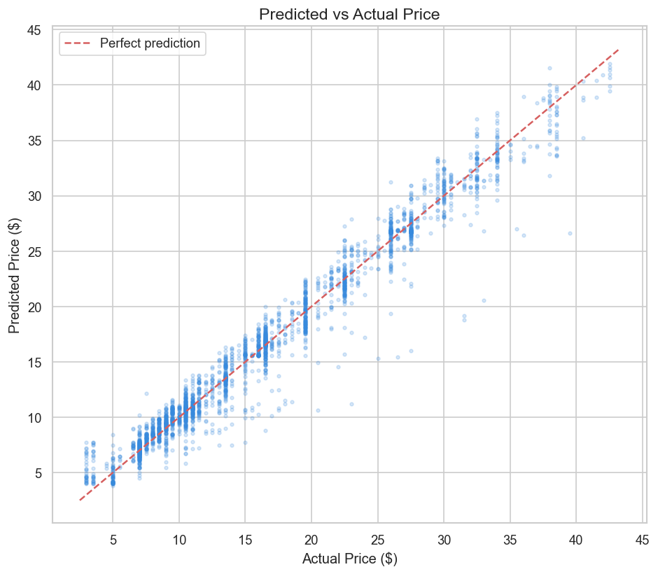

# Uber & Lyft Ride Price Prediction — Boston, MA


A regression project that predicts the price of an Uber or Lyft ride in Boston from **693,071 ride records**. After cleaning, EDA and feature engineering, four models were compared and the two ensembles were tuned. **Tuned Gradient Boosting reached R² 0.970 and RMSE $1.52 on the test set**, and 5-fold cross-validation confirmed it (CV R² 0.969 ± 0.0002).

**Course:** AML-2203 Advanced Python — AI and ML Tools, Lambton College · March 2026
**Team:** Group 2 — Krushal Sardhara and Arti Makwana

---

## Results

| Model | RMSE ($) | MAE ($) | R² |
| --- | --- | --- | --- |
| **Gradient Boosting (tuned)** | **1.521** | **1.025** | **0.970** |
| Random Forest (tuned) | 1.676 | 1.152 | 0.963 |
| Random Forest (default) | 1.714 | 1.115 | 0.961 |
| Gradient Boosting (default) | 1.771 | 1.229 | 0.959 |
| Decision Tree (depth 5) | 2.646 | 1.862 | 0.908 |
| Linear Regression (baseline) | 6.193 | 4.993 | 0.496 |

**5-fold cross-validation** (KFold, shuffled, seed 42)

| Model | CV RMSE mean ± std | CV R² mean ± std |
| --- | --- | --- |
| Gradient Boosting (tuned) | 1.529 ± 0.005 | 0.969 ± 0.0002 |
| Random Forest (tuned) | 1.683 ± 0.006 | 0.963 ± 0.0003 |



## Approach

1. **Cleaning** — dropped rows with a missing price, parsed the timestamp, removed duplicates and rides with price or distance ≤ 0, filled remaining nulls (median for numbers, mode for categories), and removed price and distance outliers with the IQR rule (625,229 rows kept).
2. **Encoding** — `cab_type` as binary (Uber 0, Lyft 1); ride tier, pickup and drop-off locations label-encoded.
3. **EDA** — eight charts: price by cab type and ride tier, distance vs price, surge frequency, price by hour and weekday, correlation heatmap, top pickup locations.
4. **Feature engineering** — hour, day of week, month, weekend, rush-hour (7–9am, 4–7pm) and night (10pm–5am) flags, a `surge × distance` interaction and distance buckets; standard scaling; 80/20 train-test split.
5. **Modelling** — Linear Regression and Decision Tree baselines, then Random Forest and Gradient Boosting tuned with `RandomizedSearchCV` (20 iterations, 3-fold).
6. **Validation and analysis** — 5-fold cross-validation, feature importance, predicted-vs-actual and residual plots.

| Feature importance | Predicted vs actual |
| --- | --- |
|  |  |

## Key insights

- **Distance, surge multiplier and ride tier drive price.** The engineered `surge × distance` feature was one of the top five predictors.
- **Uber and Lyft price similarly** at the same distance and tier; Lyft's Lux tiers stretch its upper price range.
- **Time of day and weekday matter, but less** than tier and surge; late-night and weekend rides trend slightly higher.
- **Tree ensembles beat linear regression by a wide margin** (R² 0.97 vs 0.50) because pricing is non-linear.
- **Tuning paid off most for Gradient Boosting**: RMSE fell 14% (1.77 → 1.52), while Random Forest improved about 2% (1.71 → 1.68).

## Team contributions

| Member | Contributions |
| --- | --- |
| Krushal Sardhara | Data loading and inspection; data cleaning (missing values, datetime fixing, outlier removal); baseline models (Linear Regression, Decision Tree); Random Forest modelling and hyperparameter tuning; methodology section of the report |
| Arti Makwana | Duplicate and invalid-row removal; categorical encoding; EDA visualizations; feature engineering (datetime features, scaling, train/test split); post-modelling analysis (feature importance, residuals); report writing and presentation |

## How to run

1. Download `rideshare_kaggle.csv` from the [Uber and Lyft Dataset Boston, MA](https://www.kaggle.com/datasets/brllrb/uber-and-lyft-dataset-boston-ma) on Kaggle and save it in the repository root (it is not committed).
2. Install the dependencies and open the notebook:
   ```bash
   pip install -r requirements.txt
   jupyter notebook uber_lyft_price_prediction.ipynb
   ```
3. Run all cells. Hyperparameter tuning takes a few minutes.

## Limitations

- The data covers only November–December 2018 in Boston, so seasonal and year-over-year effects aren't captured.
- Weather columns were not used, although weather is known to affect surge pricing.
- Distance is straight-line, so routes, traffic and detours aren't modelled.
- Locations are label-encoded; target encoding or embeddings could represent them better.

## Repository structure

```
uber-lyft-price-prediction/
├── uber_lyft_price_prediction.ipynb   # full pipeline with outputs
├── docs/
│   └── project_report.pdf             # final course report
├── images/                            # charts used in this README
├── requirements.txt
└── README.md
```
